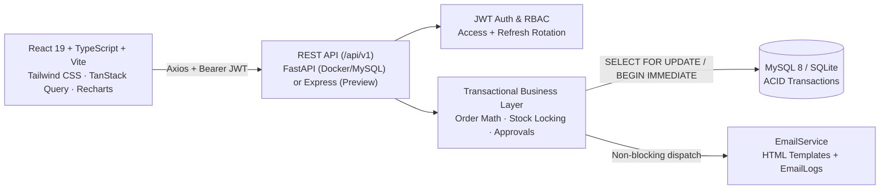
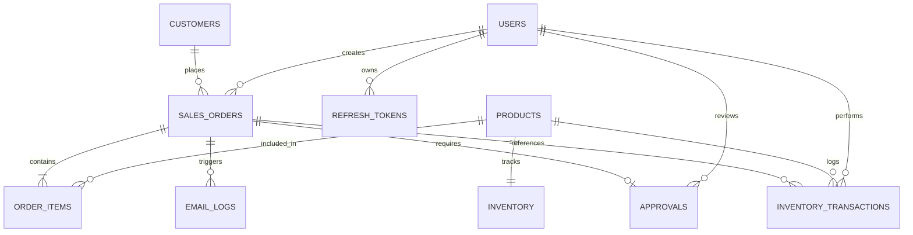

# Meridian ERP — Sales & Inventory Management System

A full-stack, enterprise-grade Sales & Inventory Management System featuring multi-role RBAC (`ADMIN`, `MANAGER`, `SALES_EMPLOYEE`), real-time stock availability & reservation, configurable manager approval thresholds, SMTP email notifications with retry logging, and role-specific analytics dashboards.

---

## 1. Project Overview

Meridian ERP enables B2B distribution and industrial supply businesses to manage:
- **Product Catalog**: SKU validation, unit/cost pricing, reorder thresholds, and safe deactivation when referenced by historical orders.
- **Customer Directory**: Corporate client profiles, billing/shipping addresses, and full order histories.
- **Inventory & Ledger**: Real-time `Available = On Hand - Reserved` tracking, non-negative stock enforcement, and immutable `inventory_transactions` audit trails.
- **Sales Orders**: Multi-line order creation with authoritative server-side financial calculations (`Subtotal - Discount + Tax`).
- **Manager Approval Workflow**: Configurable monetary threshold (default `₹50,000`). Orders within threshold confirm immediately; orders above threshold atomically reserve inventory, trigger a manager approval email, and route to the Approval Queue.
- **Role-Based Dashboards & Reports**: Real database-driven KPI cards, Recharts revenue/inventory visualizations, CSV exports, and email delivery audit logs.

---

## 2. Architecture Diagram



---

## 3. Database ER Diagram



---

## 4. Folder Structure

```text
sales-inventory-management/
├── src/                        # React + TypeScript + Vite Frontend
│   ├── api/                    # Axios client with automatic JWT refresh interceptor
│   ├── components/             # Reusable StatusBadge, Modal, Pagination, ProtectedRoute
│   ├── context/                # AuthContext & ToastContext
│   ├── layouts/                # Dark navy sidebar & topbar layout
│   ├── pages/                  # All 19 ERP pages (Auth, Dashboards, Products, Customers, Inventory, Orders, Approvals, Reports, Users, Settings, Profile)
│   ├── types/                  # TypeScript domain interfaces
│   └── utils/                  # Currency, date, and error formatting helpers
├── server/                     # Express + SQLite live full-stack server (port 3000 preview)
├── backend/                    # Python 3.11+ FastAPI + SQLAlchemy 2.x + Alembic + MySQL 8 backend
│   ├── alembic/                # Database migrations (001_initial_schema.py)
│   ├── app/api/v1/             # Versioned REST endpoints
│   ├── app/core/               # Config, security (JWT/bcrypt), exceptions
│   ├── app/db/                 # SQLAlchemy session & seed script
│   ├── app/models/             # 12 SQLAlchemy ORM models
│   ├── app/schemas/            # Pydantic v2 schemas
│   ├── app/services/           # Transactional Order, Approval, Inventory & Email services
│   ├── app/templates/          # Jinja2 HTML email templates
│   └── tests/                  # 25 Pytest automated tests
├── tests/                      # 26 Vitest + Supertest API & transaction tests
├── docker-compose.yml          # MySQL 8 + FastAPI + Vite container orchestration
└── .env.example                # Root environment template
```

---

## 5. User Roles & Permissions

| Capability | Admin | Manager | Sales Employee |
| :--- | :---: | :---: | :---: |
| Create / Edit / Deactivate Products | Yes | No | No |
| Manage Users & Roles | Yes | No | No |
| Configure Approval Threshold | Yes | No | No |
| Manage Customers | Yes | Yes | Yes (Create/Edit) |
| Adjust Inventory Stock | Yes | Yes | No |
| Create Sales Orders | Yes | Yes | Yes |
| View All Orders vs. Own Orders | All | All | Own Only |
| Approve / Reject Pending Orders | Yes (not own) | Yes (not own) | No |
| View Executive / Manager Reports | Yes | Yes | No |

---

## 6. Approval & Inventory Reservation Workflow

1. **Order Submission**: Sales Employee submits an order. Backend locks inventory rows, validates active customer/products and available stock, and computes `Grand Total = Sum(Qty × DB Unit Price) - Discount + Tax`.
2. **Below / Equal Threshold (e.g. `<= ₹50,000`)**: Order status becomes `CONFIRMED`, `quantity_on_hand` is deducted immediately, and a `STOCK_DEDUCTED` ledger entry is written.
3. **Above Threshold (`> ₹50,000`)**: Order status becomes `PENDING_APPROVAL`, `reserved_quantity` increases atomically (`STOCK_RESERVED`), an `Approval` record is created, and an email notification is sent to the Manager.
4. **Manager Approves**: Inside a database transaction, `quantity_on_hand` and `reserved_quantity` are both decremented (`STOCK_DEDUCTED`), order becomes `CONFIRMED`, and an approval email is sent to the Sales Employee.
5. **Manager Rejects (Reason Mandatory)**: `reserved_quantity` is decremented back to available inventory (`STOCK_RELEASED`), order becomes `REJECTED`, and a rejection email with reason is sent.
6. **Cancellation**: Cancelling a `PENDING_APPROVAL` order releases reserved stock; cancelling a `CONFIRMED` / `PROCESSING` order restores `quantity_on_hand` once and prevents duplicate restoration.

---

## 7. API Endpoints (`/api/v1`)

- **Auth**: `POST /auth/login`, `POST /auth/refresh`, `POST /auth/logout`, `GET /auth/me`, `POST /auth/change-password`
- **Users**: `GET /users`, `POST /users`, `GET /users/{id}`, `PUT /users/{id}`, `DELETE /users/{id}`
- **Products**: `GET /products`, `POST /products`, `GET /products/{id}`, `PUT /products/{id}`, `DELETE /products/{id}`
- **Customers**: `GET /customers`, `POST /customers`, `GET /customers/{id}`, `PUT /customers/{id}`, `DELETE /customers/{id}`
- **Inventory**: `GET /inventory`, `GET /inventory/{product_id}`, `POST /inventory/adjustments`, `GET /inventory/transactions`, `GET /inventory/low-stock`
- **Orders**: `GET /orders`, `POST /orders`, `GET /orders/{id}`, `PUT /orders/{id}`, `POST /orders/{id}/cancel`, `GET /orders/{id}/items`
- **Approvals**: `GET /approvals/pending`, `GET /approvals/history`, `GET /approvals/{id}`, `POST /approvals/{id}/approve`, `POST /approvals/{id}/reject`
- **Dashboard & Settings**: `GET /dashboard/admin`, `GET /dashboard/sales`, `GET /dashboard/manager`, `GET /reports/summary`, `GET /settings`, `PUT /settings/approval-threshold`, `GET /emails`, `POST /emails/{id}/retry`

---

## 8. Setup & Execution

### Option A: Live Full-Stack Mode (Node.js + Vite + SQLite on Port 3000)
```bash
cp .env.example .env
npm install
npm run dev
```
Open `http://localhost:3000`.

### Option B: Docker Compose (MySQL 8 + FastAPI + React Vite)
```bash
docker compose up --build
```
- Frontend: `http://localhost:5173`
- FastAPI Swagger UI: `http://localhost:8000/docs`

### Option C: Local Python FastAPI + MySQL 8
```bash
cd backend
cp .env.example .env
python -m venv .venv && source .venv/bin/activate
pip install -r requirements.txt
alembic upgrade head
python -m app.db.seed
uvicorn app.main:app --reload --port 8000
```

---

## 9. Running Automated Tests

- **Vitest + Supertest API & Transaction Suite (26 tests)**:
  ```bash
  npm test
  ```
- **Pytest FastAPI Suite (25 tests)**:
  ```bash
  cd backend && pytest -v
  ```

---

## 10. Seeded Development Login Credentials

All development accounts use password: **`Password123!`** (change immediately in production).

| Role | Email | Password |
| :--- | :--- | :--- |
| Admin | `admin@example.com` | `Password123!` |
| Manager | `manager@example.com` | `Password123!` |
| Sales Employee | `sales@example.com` | `Password123!` |
| Sales Employee 2 | `ananya@example.com` | `Password123!` |
